# Stage 6: Relationship-Aware Attack Path Analysis Engine

## Overview

The **Relationship-Aware Attack Path Analysis Engine** is a static analysis service in **IaC Risk Composer — Threat Model-as-Code Engine** that uncovers how an attacker could potentially traverse infrastructure resources from an externally exposed entry point to sensitive data or privilege assets.

Static IaC security analysis often identifies misconfigured resources in isolation (e.g. an open security group, an administrative IAM role, or an unencrypted S3 bucket). The attack path engine correlates these individual resources and threat findings into multi-hop, directed attack graphs, providing security teams with concrete, explainable attack narratives across **Terraform**, **AWS CloudFormation**, and **Kubernetes**.

---

## 1. Architecture

The Attack Path Analysis Engine is implemented as an independent service in [`services/attack_path_engine.py`](file:///c:/ibm_bob/iac/iac-risk-composer-redesigned/project/backend/services/attack_path_engine.py). It operates on the `NormalizedInfrastructure` model produced by the parser registry and integrates with the existing threat detection and risk assessment pipeline.

```mermaid
flowchart LR
    A["Uploaded IaC (.tf, .yaml, .json)"] --> B["Parser Registry"]
    B --> C["NormalizedInfrastructure"]
    C --> D["Threat Detection Engine"]
    C --> E["Attack Path Engine"]
    D --> E
    E --> F["Directed Infrastructure Graph"]
    F --> G["DFS Path Discovery"]
    G --> H["Risk & Confidence Assessment"]
    H --> I["Standardized Attack Paths"]
    I --> J["FastAPI Response & Persistence"]
```



### Safety & Governance
* **Static Analysis Only**: Operates strictly on declared IaC configurations. Never executes code, deploys cloud infrastructure, or connects to live cloud APIs.
* **Non-Speculative Graph Construction**: Edges are constructed strictly when actual relationships (references, bindings, selector matches) are resolved. No edges are fabricated based on naming proximity or file co-location.
* **Status Integrity**: Preserves `Provisional` status and records unresolved references whenever complete context is absent.

---

## 2. Component Classification

Resources are categorized into functional security tiers:

| Category | Description | Example Types |
| :--- | :--- | :--- |
| **External Entry Points** | Network gates exposed to public or untrusted ingress | Open Security Groups (`0.0.0.0/0`), Public Load Balancers, Internet Gateways, Public S3 Buckets, Kubernetes Ingress, NodePort/LoadBalancer Services |
| **Workloads** | Compute runtime execution contexts | EC2 Instances (`aws_instance`, `AWS::EC2::Instance`), Lambda Functions, Kubernetes Pods and Deployments |
| **Privileges & Identities** | Access policies and execution identities | IAM Roles, Instance Profiles, Policies, Kubernetes ServiceAccounts, Roles, ClusterRoles, RoleBindings |
| **Sensitive Resources** | Target data stores and confidential assets | S3 Buckets, RDS Databases, EBS Volumes, Kubernetes Secrets, PersistentVolumes |

---

## 3. Supported Resource Relationships

The engine resolves directional security and data flow across three major IaC ecosystems:

### Terraform
* **`aws_security_group` $\rightarrow$ `aws_instance`**: Security group attached via `vpc_security_group_ids` or `security_groups`. Ingress exposure governs network traffic to the instance (`exposes`).
* **`aws_instance` $\rightarrow$ `aws_iam_role`**: Instance assigned IAM instance profile referencing an IAM role (`assumes_role`).
* **`aws_iam_role` $\rightarrow$ `aws_s3_bucket` / `aws_db_instance`**: Policy statements granting permissions over S3 buckets or database instances, including wildcard administrator access (`grants_access`).
* **`aws_instance` $\rightarrow$ `aws_ebs_volume`**: Attached EBS volume (`attaches_storage`).
* **`aws_lb` / `aws_elb` $\rightarrow$ `aws_instance`**: Load balancer forwarding public traffic to compute targets (`routes_to`).

### AWS CloudFormation
* **`AWS::EC2::SecurityGroup` $\rightarrow$ `AWS::EC2::Instance`**: Resolved via `SecurityGroupIds` property and `!Ref` intrinsics (`exposes`).
* **`AWS::EC2::Instance` $\rightarrow$ `AWS::IAM::Role`**: Resolved via `IamInstanceProfile` referencing an `AWS::IAM::InstanceProfile` or `AWS::IAM::Role` (`assumes_role`).
* **`AWS::Lambda::Function` $\rightarrow$ `AWS::IAM::Role`**: Function execution role resolved via `Role` property (`assumes_role`).
* **`AWS::IAM::Role` $\rightarrow$ `AWS::S3::Bucket` / `AWS::RDS::DBInstance`**: Role permissions targeting storage/database logical IDs, or administrative wildcard (`CFN-003`) coverage (`grants_access`).
* **`AWS::EC2::Instance` $\rightarrow$ `AWS::EC2::Volume`**: Volume attached via `AWS::EC2::VolumeAttachment` or block device mappings (`attaches_storage`).

### Kubernetes
* **`Ingress` $\rightarrow$ `Service`**: Ingress rules directing HTTP/HTTPS traffic to backend services (`routes_to`).
* **`Service` $\rightarrow$ `Workload` (`Pod`, `Deployment`)**: Service selector label matching workload template labels (`routes_to`).
* **`Workload` $\rightarrow$ `ServiceAccount`**: Declared `serviceAccountName` on the pod specification (`assumes_identity`).
* **`Workload` $\rightarrow$ `Secret`**: Volume mounts (`secret.secretName`) or environment variable references (`valueFrom.secretKeyRef`) (`accesses_secret`).
* **`ServiceAccount` $\rightarrow$ `RoleBinding` $\rightarrow$ `Role` / `ClusterRole`**: RBAC role bindings associating service accounts with permissions (`binds_to` and `grants_role`).
* **`Role` / `ClusterRole` $\rightarrow$ `Secret`**: RBAC permissions permitting read/list/watch operations over `secrets` (`grants_permission`).

---

## 4. Attack Path Discovery Algorithm

Path discovery is implemented using depth-first search (DFS) traversal starting exclusively from validated **External Entry Points**:

1. **Cycle and Loop Prevention**: Maintains a `current_path` set tracking visited nodes in the current branch. If a neighbor is already in `current_path`, traversal prunes the branch.
2. **Depth Limiting**: Constrained by `MAX_TRAVERSAL_DEPTH = 8` to avoid unbounded exploration.
3. **Result Capping**: Limits returned paths to `MAX_DISCOVERED_PATHS = 25` most direct paths.
4. **Deduplication**: Graph edges are deduplicated by `(source, target, relationship)`. Discovered paths are deduplicated by canonical node tuple `tuple(resource_path)`.
5. **Direct Exposure Tracking**: If a sensitive resource is directly exposed (e.g. S3 bucket with public ACL), it is captured as a 1-hop direct compromise path.

---

## 5. Risk Assessment & Classification

Attack path severity and confidence are evaluated conservatively based on concrete evidence:

* **Severity**:
  * `Critical`: Path reaches a sensitive resource (S3 bucket, RDS database, Secret) and contains at least one confirmed critical finding (e.g. `THREAT-001`, `CFN-003`, `CFN-004`, `K8S-001`, `K8S-009`).
  * `High`: Path reaches a sensitive resource from an external entry point with confirmed workload and privilege connectivity.
  * `Medium`: Path connects an exposed service (e.g. NodePort) to a workload or unencrypted storage without confirmed privilege escalation.
  * `Low`: Low-risk or indirect connectivity.
  * `Needs Review`: Assigned if findings along the path are provisional or require external review.
* **Confidence**:
  * `High`: All edges explicitly declared in the template with confirmed configuration values.
  * `Medium`: Path contains inferred relationships (e.g. selector matching across documents).
  * `Low`: Path depends on unresolved external references.
* **Assessment Status**:
  * `Confirmed`: All links and findings along the path are confirmed.
  * `Provisional`: Any link contains `Needs Review` findings or unresolved references.

---

## 6. Standardized Output Schema

Each attack path produces a structured JSON output:

```json
{
  "path_id": "AP-001",
  "source_format": "terraform",
  "entry_point": "aws_security_group.web_sg",
  "target_resource": "aws_s3_bucket.data_vault",
  "resource_path": [
    "aws_security_group.web_sg",
    "aws_instance.web_server",
    "aws_iam_role.app_role",
    "aws_s3_bucket.data_vault"
  ],
  "severity": "Critical",
  "confidence": "High",
  "assessment_status": "Confirmed",
  "description": "Potential attack path starting from exposed entry point 'aws_security_group.web_sg', progressing through 2 intermediate resource(s), and reaching sensitive target 'aws_s3_bucket.data_vault'.",
  "evidence": [
    {
      "step": 1,
      "source": "aws_security_group.web_sg",
      "target": "aws_instance.web_server",
      "relationship": "exposes",
      "details": "Security group controls inbound network traffic reaching this EC2 instance."
    },
    {
      "step": 2,
      "source": "aws_instance.web_server",
      "target": "aws_iam_role.app_role",
      "relationship": "assumes_role",
      "details": "EC2 instance executes with privileges granted by IAM role."
    },
    {
      "step": 3,
      "source": "aws_iam_role.app_role",
      "target": "aws_s3_bucket.data_vault",
      "relationship": "grants_access",
      "details": "IAM role policy permits operations on S3 bucket."
    }
  ],
  "related_findings": ["THREAT-001"],
  "limitations": [
    "Analysis assumes standard AWS security boundary defaults without evaluating unmodeled VPC peering or SCPs."
  ]
}
```

---

## 7. API Integration

### `POST /api/analyze`
* Executes the complete 7-step analysis pipeline.
* Computes `attack_paths` and includes them in `TerraformAnalysisResponse`.
* Automatically persists attack paths in the SQLite database within `full_analysis_json`.

### `GET /api/analysis/{analysis_id}/attack-paths`
* Dedicated endpoint to fetch all discovered attack paths for a stored analysis report ID.
* Returns HTTP 404 if the analysis ID does not exist.

---

## 8. Limitations & False-Positive Considerations

1. **Unmodeled External Identity Providers**: If an IAM role or ServiceAccount trusts an external IDP (OIDC/SAML) outside the uploaded template, external ingress is marked as an unresolved reference rather than creating speculative edges.
2. **Dynamic Kubernetes Selectors**: Selector matching assumes standard exact key-value equality. Complex matchExpressions (e.g. `NotIn`, `Exists`) without explicit values are handled conservatively.
3. **Out-of-Band Network Policies**: Manifests without an inline `NetworkPolicy` report a static limitation indicating that cluster-wide network policies may enforce isolation at runtime.

---

## 9. Verification & Test Results

The engine is validated by a dedicated test suite in [`tests/test_attack_path_engine.py`](file:///c:/ibm_bob/iac/iac-risk-composer-redesigned/project/backend/tests/test_attack_path_engine.py):

* **Total Backend Tests**: **156 passed, 0 failures**
* **Stage 6 Specific Tests**: **14 passed**
  1. `test_1_public_ec2_iam_role_s3_path` (Terraform Public EC2 $\rightarrow$ IAM Role $\rightarrow$ S3)
  2. `test_2_k8s_ingress_service_pod_path` (Kubernetes Ingress $\rightarrow$ Service $\rightarrow$ Pod $\rightarrow$ Secret)
  3. `test_3_k8s_pod_sa_rolebinding_role_path` (Kubernetes Pod $\rightarrow$ SA $\rightarrow$ RoleBinding $\rightarrow$ Role $\rightarrow$ Secret)
  4. `test_4_workload_sensitive_storage_path` (CloudFormation Public SG $\rightarrow$ EC2 $\rightarrow$ EBS Volume)
  5. `test_5_infrastructure_no_attack_paths` (Private infrastructure yields 0 paths)
  6. `test_6_cyclic_relationships` (Graph cycles handled safely without loops)
  7. `test_7_duplicate_relationships` (Redundant edges and paths deduplicated)
  8. `test_8_unresolved_resource_references` (External references recorded as limitations)
  9. `test_9_missing_threat_findings` (Resilient path discovery with empty findings)
  10. `test_10_needs_review_classification_for_incomplete_evidence` (Provisional status verified)
  11. `test_11_terraform_regression` (Terraform analysis pipeline preservation)
  12. `test_12_cloudformation_regression` (CloudFormation analysis pipeline preservation)
  13. `test_13_kubernetes_regression` (Kubernetes analysis pipeline preservation)
  14. `test_14_api_analyze_and_get_attack_paths_endpoint` (API persistence and retrieval verification)
